# Approval System: how a request flows, step by step

*A walkthrough built from passing end-to-end tests · report date 2026-10-21*

> **103 end-to-end tests, all passing:** 44 rejection-and-recovery cases, 48 business-workflow tests and 11 admin-security tests. Every screenshot below was taken by one of these tests in a real browser.

## Results at a glance

| Area | What it covers | Result | Last run | Run on the final code? |
|---|---|---|---|---|
| Rejection and recovery | 44 cases: reject at any stage, fix, resubmit, finish | **44 / 44 passed** | 2026-10-21 | Yes |
| Who may start Final (T08E, T10C) | The parent department’s manager is denied; the requester’s own unit starts Final | **2 / 2 passed** | 2026-10-21 | Yes |
| Business workflow suite (T01–T20) | End-to-end journeys, rules and safeguards | **46 / 46 passed** | 2026-10-06 | No: before the Oct 19–21 review fixes |
| Admin security | Who can reach and change the admin area | **11 / 11 passed** | 2026-09-21 | No |
| Code checks on the merged main | Type check, 78 tool tests, 3,364 regression tests, production build, upgrade rehearsal | **All passed** (3,362 passed, 2 skipped by design, 0 failed) | 2026-10-21 | Yes |

**“Run on the final code: Yes”** means no product code changed after that run. **“No”** means the test passed on an earlier version and has not been re-run since; its date is shown so nothing looks newer than it is.

## The flow in one picture

|  | Stage | Who acts | Approval chain (default) | Result |
|---|---|---|---|---|
| 1 | **Request** | The requester submits a request | Supervisor → Section manager → Department manager | The request goes to Engineering |
| 2 | **Solution** | Engineering submits a solution | Engineering’s Supervisor → Engineering’s Section manager → Department manager | Solution approved; back to the requester |
| 3 | **Final** | The requester (or someone in the requester’s unit) starts Final approval | Section manager → Department manager | **Completed** |

At every approval step the approver can **approve**, or **reject with a reason**. A rejection sends the work back to the right person to fix and resubmit, and the approvals start again. Each stage below shows the normal path first, then what happens after a rejection.

## Stage 1: the Request

### 1.1 The requester submits a request

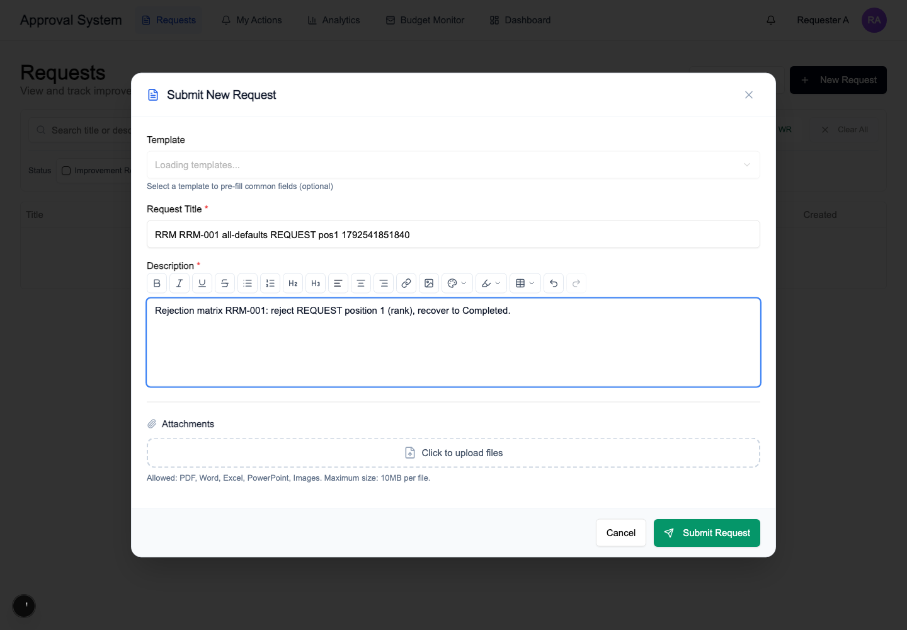
*Figure 1. Submit New Request: a title, a description and optional attachments.*

The requester chooses **New Request**, writes a title and a description (attachments are optional) and submits. The first approver is notified in the app.

### 1.2 Approvers decide, one after another

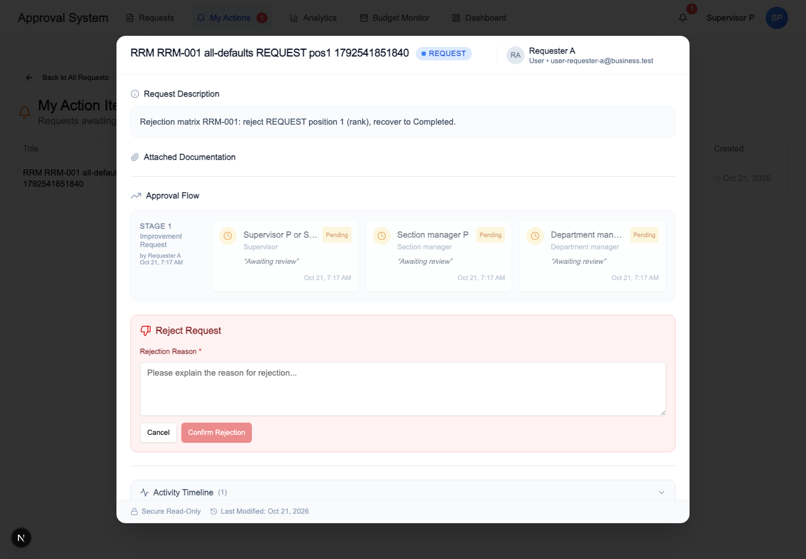
*Figure 2. The approver’s view: the whole approval flow, who is still pending, and the Reject box (opened here).*

Approvers find the request under **My Actions** when it is their turn. They see the whole chain (here Supervisor → Section manager → Department manager) and can approve or reject. **Confirm Rejection stays disabled until a reason is typed.** Nobody can decide out of turn, and nobody approves their own request: if the requester is a Supervisor, the Supervisor step is skipped.

### 1.3 If an approver rejects the request

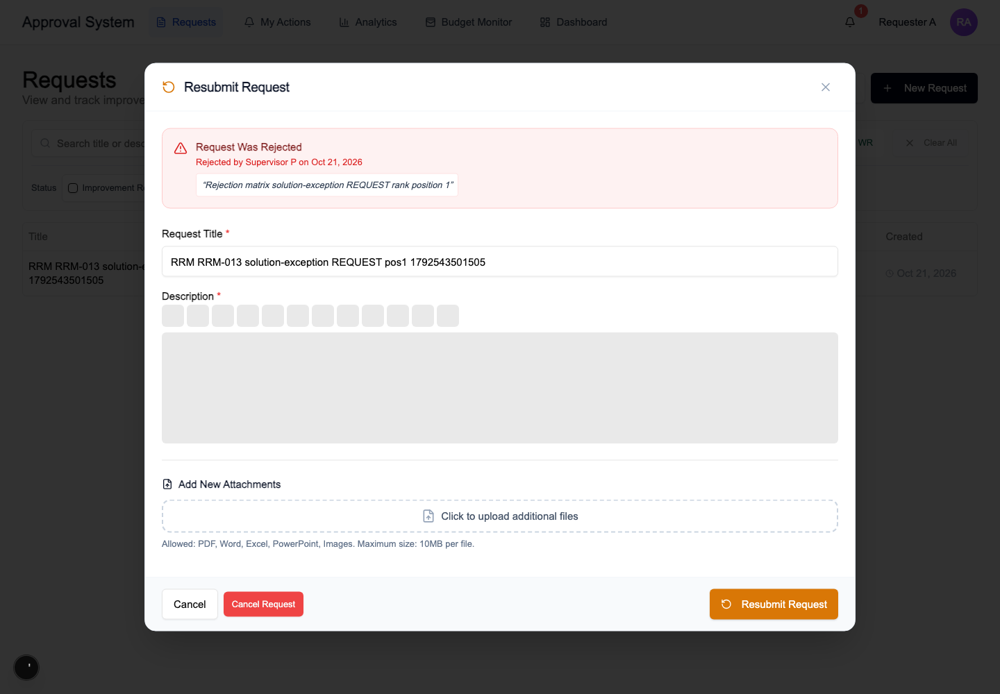
*Figure 3. The requester sees who rejected the request, when and why, and can edit and resubmit it.*

The requester sees **Request Was Rejected** with the name of the approver, the date and the reason. They fix the request and press **Resubmit Request**. The approvals start again from step 1; earlier approvals are not carried over.

### Passing tests for Stage 1

| Test | What it proves | Last passed |
|---|---|---|
| T01 | A requester signs in and creates a request. | 2026-10-06 |
| T01 | A Supervisor signs in and creates a request. | 2026-10-06 |
| T01 | A deactivated user cannot sign in. | 2026-10-06 |
| T02A | Request approvals happen in order. Someone out of turn, or outside the approver group, cannot decide. | 2026-10-06 |
| T02B | When the requester is a Supervisor, the Supervisor step is skipped, so nobody approves their own request. | 2026-10-06 |
| T14A | Rejecting a Request needs a reason; the requester resubmits; a non-permitted person is denied; replaying a stale rejection after the resubmit is denied. | 2026-10-06 |

**Rejection and recovery cases that reject at the Request stage (12, all passed 2026-10-21):**

| Case | Route setup | Rejected by | Chain | Result |
|---|---|---|---|---|
| RRM-001 | All default chains | Supervisor (step 1) | Default (by position) | ✅ Completed |
| RRM-002 | All default chains | Section manager (step 2) | Default (by position) | ✅ Completed |
| RRM-003 | All default chains | Department manager (step 3) | Default (by position) | ✅ Completed |
| RRM-013 | Solution exception chain | Supervisor (step 1) | Default (by position) | ✅ Completed |
| RRM-014 | Solution exception chain | Section manager (step 2) | Default (by position) | ✅ Completed |
| RRM-015 | Solution exception chain | Department manager (step 3) | Default (by position) | ✅ Completed |
| RRM-024 | Final exception chain | Supervisor (step 1) | Default (by position) | ✅ Completed |
| RRM-025 | Final exception chain | Section manager (step 2) | Default (by position) | ✅ Completed |
| RRM-026 | Final exception chain | Department manager (step 3) | Default (by position) | ✅ Completed |
| RRM-035 | Solution + Final exception chains | Supervisor (step 1) | Default (by position) | ✅ Completed |
| RRM-036 | Solution + Final exception chains | Section manager (step 2) | Default (by position) | ✅ Completed |
| RRM-037 | Solution + Final exception chains | Department manager (step 3) | Default (by position) | ✅ Completed |

## Stage 2: the Solution

When the last Request approver says yes, the request goes to Engineering.

### 2.1 Engineering submits a solution

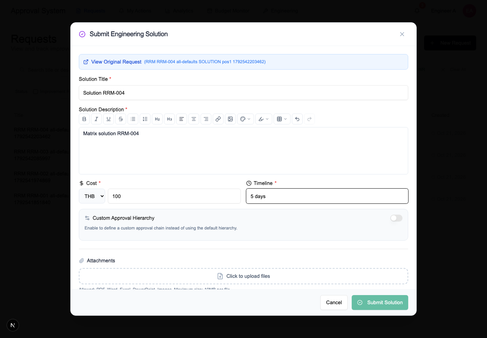
*Figure 4. Submit Engineering Solution: title, description, cost, timeline and an optional custom approval hierarchy.*

An engineer submits an **Engineering Solution**: a title, a description, the cost and the timeline. Staff of the requester’s section, people from a sibling section and inactive users cannot submit one, and nothing is half-saved. The engineer can also define a custom approval chain for the solution (see “Custom approval chains”).

### 2.2 The solution is approved

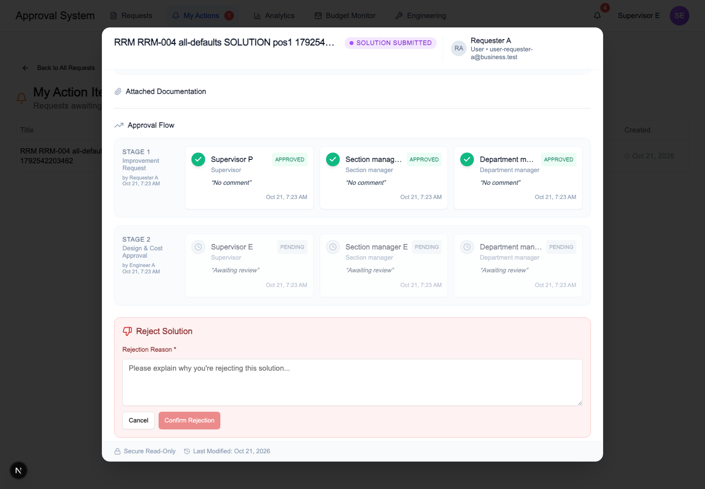
*Figure 5. Stage 1 is complete (all approved); Stage 2, Design & Cost Approval, has three pending steps. The approver can approve or reject.*

The solution goes through its own chain: here Engineering’s Supervisor → Engineering’s Section manager → Department manager. The approver sees the earlier Request approvals and the pending Solution steps, and approves or rejects (a reason is required).

### 2.3 If the solution is rejected

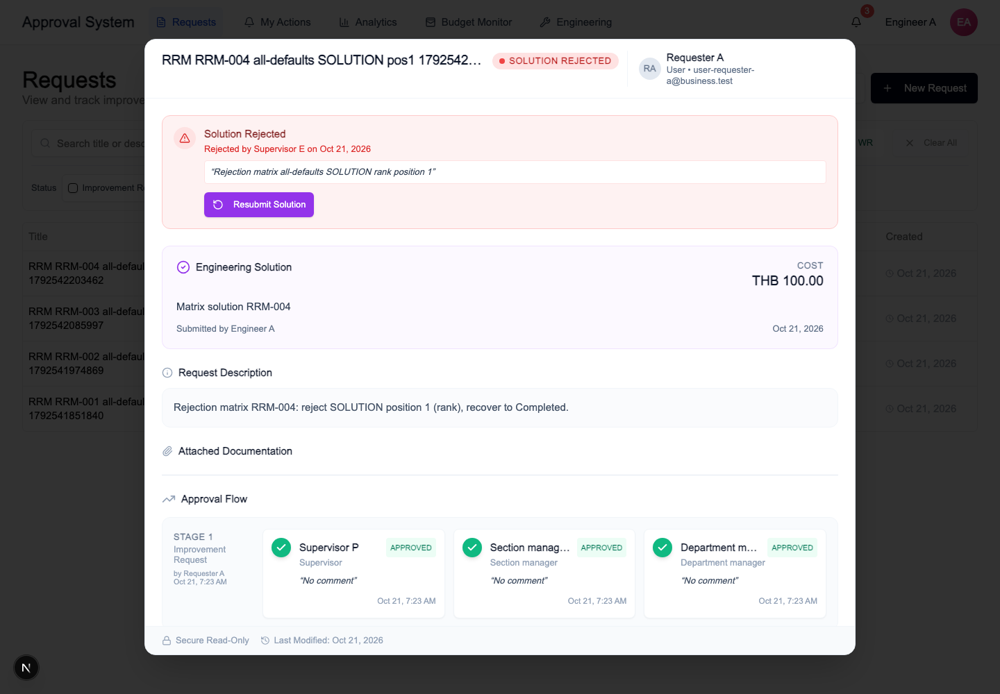
*Figure 6. Solution Rejected: Engineering sees who rejected, when and why, with a Resubmit Solution button.*

Engineering sees **Solution Rejected** with the reason and a **Resubmit Solution** button. After they resubmit, the Solution approvals start again from step 1.

### Passing tests for Stage 2

| Test | What it proves | Last passed |
|---|---|---|
| T03A | Engineering submits a solution; the first Solution approval goes to Engineering’s Supervisor. | 2026-10-06 |
| T03B | When the engineer is a Supervisor, that step is skipped and the Section manager decides first. | 2026-10-06 |
| T03C | Staff, people from a sibling section and inactive users cannot submit a solution, and nothing is half-saved. | 2026-10-06 |
| T14B | Rejecting a Solution needs a reason; Engineering resubmits; a non-permitted person is denied. | 2026-10-06 |

**Rejection and recovery cases that reject at the Solution stage (18, all passed 2026-10-21):**

| Case | Route setup | Rejected by | Chain | Result |
|---|---|---|---|---|
| RRM-004 | All default chains | Supervisor (step 1) | Default (by position) | ✅ Completed |
| RRM-005 | All default chains | Section manager (step 2) | Default (by position) | ✅ Completed |
| RRM-006 | All default chains | Department manager (step 3) | Default (by position) | ✅ Completed |
| RRM-009 | All default chains | Named approver #1 | Exception chain (named people) | ✅ Completed |
| RRM-010 | All default chains | Named approver #2 | Exception chain (named people) | ✅ Completed |
| RRM-016 | Solution exception chain | Section manager (step 1) | Default (by position) | ✅ Completed |
| RRM-017 | Solution exception chain | Department manager (step 2) | Default (by position) | ✅ Completed |
| RRM-020 | Solution exception chain | Named approver #1 | Exception chain (named people) | ✅ Completed |
| RRM-021 | Solution exception chain | Named approver #2 | Exception chain (named people) | ✅ Completed |
| RRM-027 | Final exception chain | Supervisor (step 1) | Default (by position) | ✅ Completed |
| RRM-028 | Final exception chain | Section manager (step 2) | Default (by position) | ✅ Completed |
| RRM-029 | Final exception chain | Department manager (step 3) | Default (by position) | ✅ Completed |
| RRM-031 | Final exception chain | Named approver #1 | Exception chain (named people) | ✅ Completed |
| RRM-032 | Final exception chain | Named approver #2 | Exception chain (named people) | ✅ Completed |
| RRM-038 | Solution + Final exception chains | Section manager (step 1) | Default (by position) | ✅ Completed |
| RRM-039 | Solution + Final exception chains | Department manager (step 2) | Default (by position) | ✅ Completed |
| RRM-041 | Solution + Final exception chains | Named approver #1 | Exception chain (named people) | ✅ Completed |
| RRM-042 | Solution + Final exception chains | Named approver #2 | Exception chain (named people) | ✅ Completed |

## Stage 3: Final approval

After the solution is approved, the request goes back to the requester (“Solution Approved & Sent to Requester”). The requester now starts **Final approval**.

### 3.1 Who can start Final approval

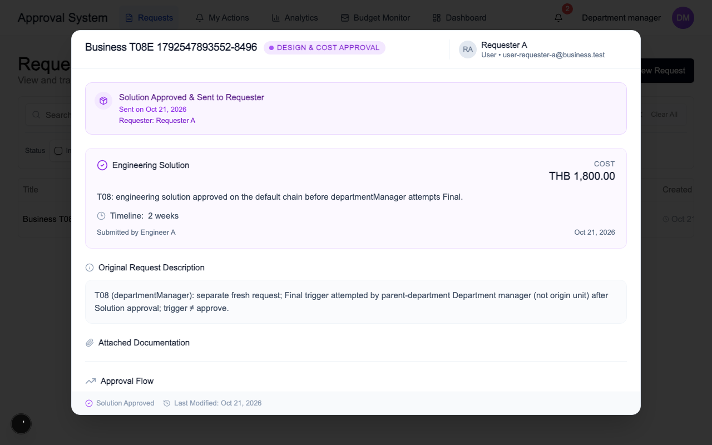
*Figure 7. The Department manager of the parent department can see the request, but there is no way to start Final.*

**Only people in the requester’s own unit can start Final approval.** In this example the Department manager of the *parent* department opens the request and sees it, but has no control to start Final. The request stays as it is and no Final attempt is created. Starting Final also gives no right to approve it: starting and deciding are separate. Attempts by the solution author, by a sibling section, or by inactive or unassigned users are denied too, whether they come before the solution is approved or after the request is Completed.

### 3.2 The requester starts Final approval

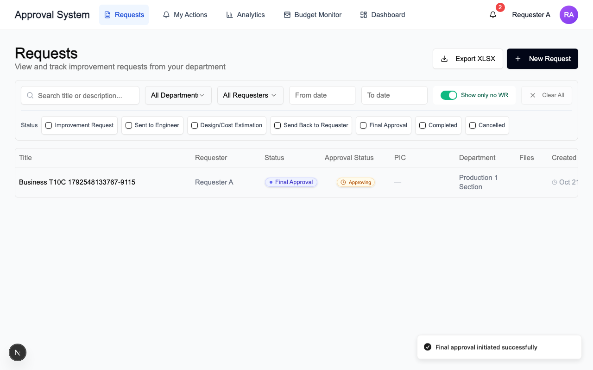
*Figure 8. After the requester starts Final: the status becomes Final Approval · Approving, and the app confirms “Final approval initiated successfully”.*

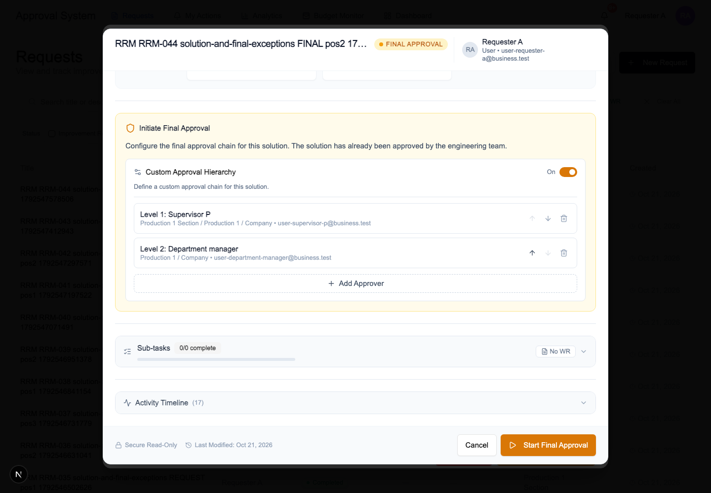
*Figure 9. Starting Final: the requester can keep the default chain or define a custom one, level by level.*

The status changes to **Final Approval · Approving** and the app confirms “Final approval initiated successfully”. When starting, the requester can keep the default chain or turn on **Custom Approval Hierarchy** and set Level 1, Level 2 and so on. Double-submitting the start produces exactly one transition.

### 3.3 Final approvers decide

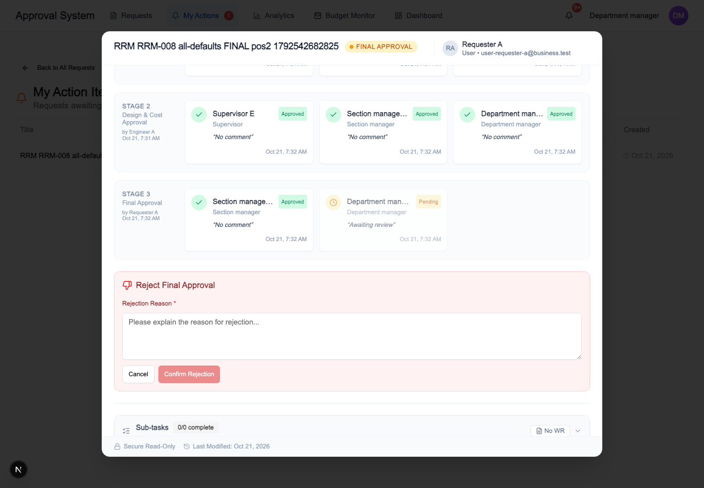
*Figure 10. The Final approver’s turn: Stage 3 shows the Section manager has approved; the Department manager is next and can approve or reject.*

Final approvers decide in order. Here the Section manager has approved and the Department manager is next, who can approve or reject (a reason is required to reject).

### 3.4 If Final approval is rejected

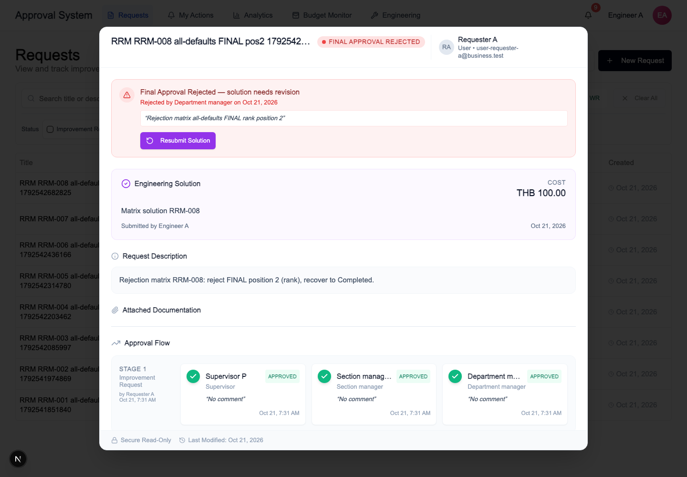
*Figure 11. Final Approval Rejected: the solution goes back to Engineering for revision, with a Resubmit Solution button.*

A rejection at Final sends the **solution** back to Engineering (“Final Approval Rejected — solution needs revision”). Engineering revises it and presses **Resubmit Solution**; the Solution approvals and then the Final approvals run again. The requester does not have to start over. Replaying an old “Confirm rejection” on the replaced attempt is denied and changes nothing.

### Passing tests for Stage 3

| Test | What it proves | Last passed |
|---|---|---|
| T08A | The requester starts Final. Starting Final gives no right to approve it; the default Final chain decides → Completed. | 2026-10-06 |
| T08B | A staff member of the requester’s unit starts Final; the default Final chain decides → Completed. | 2026-10-06 |
| T08C | A Supervisor of the requester’s unit starts Final; the default Final chain decides → Completed. | 2026-10-06 |
| T08D | The Section manager of the requester’s unit starts Final; the default Final chain decides → Completed. | 2026-10-06 |
| T08E | The Department manager of the parent department is denied the Final trigger (only the requester’s own unit may start Final). The request stays “Sent Back to Requester” and no Final attempt is created. | 2026-10-21 ✅ final code |
| T09A | Before the solution is approved, attempts to start Final by the solution author, a sibling section, an inactive user or an unassigned user are denied, with no attempt and no status change. | 2026-10-06 |
| T09B | After the request is Completed, attempts to start Final by the solution author, a sibling section, an inactive user or an unassigned user are denied, with no extra attempt. | 2026-10-06 |
| T10A | Final follows the original requester’s branch when the requester starts it; the Final exception chain (Department manager only) decides → Completed. | 2026-10-06 |
| T10B | Same when a staff member starts Final: the original requester’s branch is kept → Completed. | 2026-10-06 |
| T10C | The parent Department manager is denied; then the requester starts Final; the Final exception chain decides → Completed. | 2026-10-21 ✅ final code |
| T14C | Rejecting at Final needs a reason; Engineering revises the solution; a non-permitted person is denied. | 2026-10-06 |
| T15A | Double-submitting the Final trigger produces exactly one transition. | 2026-10-06 |

**Rejection and recovery cases that reject at the Final stage (14, all passed 2026-10-21):**

| Case | Route setup | Rejected by | Chain | Result | Stale reject replayed |
|---|---|---|---|---|---|
| RRM-007 | All default chains | Section manager (step 1) | Default (by position) | ✅ Completed | Denied ✔ |
| RRM-008 | All default chains | Department manager (step 2) | Default (by position) | ✅ Completed | Denied ✔ |
| RRM-011 | All default chains | Named approver #1 | Exception chain (named people) | ✅ Completed | Denied ✔ |
| RRM-012 | All default chains | Named approver #2 | Exception chain (named people) | ✅ Completed | Denied ✔ |
| RRM-018 | Solution exception chain | Section manager (step 1) | Default (by position) | ✅ Completed | Denied ✔ |
| RRM-019 | Solution exception chain | Department manager (step 2) | Default (by position) | ✅ Completed | Denied ✔ |
| RRM-022 | Solution exception chain | Named approver #1 | Exception chain (named people) | ✅ Completed | Denied ✔ |
| RRM-023 | Solution exception chain | Named approver #2 | Exception chain (named people) | ✅ Completed | Denied ✔ |
| RRM-030 | Final exception chain | Department manager (step 1) | Default (by position) | ✅ Completed | Denied ✔ |
| RRM-033 | Final exception chain | Named approver #1 | Exception chain (named people) | ✅ Completed | Denied ✔ |
| RRM-034 | Final exception chain | Named approver #2 | Exception chain (named people) | ✅ Completed | Denied ✔ |
| RRM-040 | Solution + Final exception chains | Department manager (step 1) | Default (by position) | ✅ Completed | Denied ✔ |
| RRM-043 | Solution + Final exception chains | Named approver #1 | Exception chain (named people) | ✅ Completed | Denied ✔ |
| RRM-044 | Solution + Final exception chains | Named approver #2 | Exception chain (named people) | ✅ Completed | Denied ✔ |

## Completed

### 4.1 Everything approved

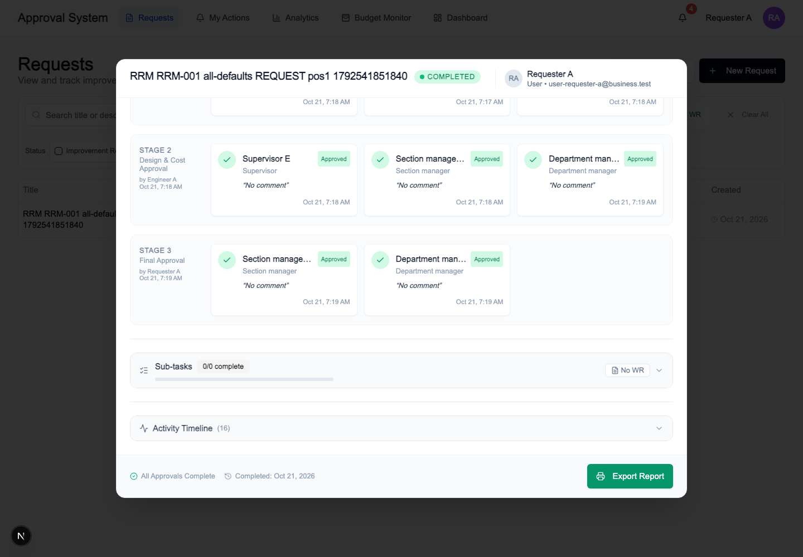
*Figure 12. Completed: all approvals recorded, “All Approvals Complete”, and the report can be exported.*

When the last approver says yes, the request is **Completed**. All approvals are recorded and the report can be exported. A completed request keeps its audit history and offers no further actions.

### 4.2 The history is kept

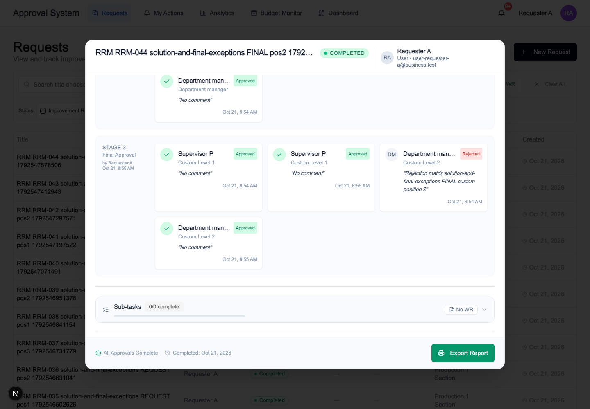
*Figure 13. A rejected Final approval stays visible, with its reason, next to the approvals that followed after the fix (custom Level 1 and Level 2).*

Rejections stay in the history. In this example a rejected approval in Stage 3 stays visible with its reason, next to the approvals that came after the fix.

### Passing tests for the complete journey

| Test | What it proves | Last passed |
|---|---|---|
| T04A | Full journey on the default chains, started by a staff member: request → solution → Final (started by the original requester) → Completed. | 2026-10-06 |
| T04B | Full journey where the requester and the engineer are Supervisors: their own steps are skipped; ends Completed. | 2026-10-06 |
| T20A | A completed request keeps its audit history and offers no further actions. | 2026-10-06 |

## Custom approval chains

Approval chains can be customized in two ways: an admin can set an **exception chain** for a unit and phase, and a person can define a **custom hierarchy** for one request when submitting a solution or starting Final (see the pictures in 2.1 and 3.2). Custom chains behave like the default ones, including rejection and recovery. The 44 rejection cases above run on four route setups: all default chains, a Solution exception, a Final exception, and both exceptions.

Pending requests keep the chain they were created with when the setup changes later; new requests follow the current setup. Invalid setups are refused before anything is saved.

### Passing tests for custom chains

| Test | What it proves | Last passed |
|---|---|---|
| T05 | Custom Solution chain: only the replacement approvers decide; Request and Final keep the default chains. | 2026-10-06 |
| T06 | Custom Final chain: the Department manager alone decides Final; Request and Solution keep the default chains. | 2026-10-06 |
| T07A | Custom Solution and Final chains together, started by a staff member, through to Completed. | 2026-10-06 |
| T07B | Custom Solution and Final chains started by Supervisors: they never approve their own work; ends Completed. | 2026-10-06 |
| T17A | Changing the Request route while a request is pending: the pending attempt keeps its captured chain; new requests follow the current setup. | 2026-10-06 |
| T17B1 | A pending Solution attempt keeps its captured chain when the Solution exception changes. | 2026-10-06 |
| T17B2 | After a Solution exception is removed, a new Solution attempt uses the current default. | 2026-10-06 |
| T17C1 | A pending Final attempt keeps its captured chain when the Final exception changes. | 2026-10-06 |
| T17C2 | After a Final exception is removed, a new Final attempt uses the current default. | 2026-10-06 |
| T19A | Invalid route drafts (duplicates, rank order, limit) are refused before anything is written. | 2026-10-06 |
| T19B | A duplicate unit/phase exception is refused and unauthorized publishing is denied; the last valid setup stays usable. | 2026-10-06 |

## Other protections

Safeguards around the main flow: who can see a request, who is notified, what happens when two people act at once, when something fails, when an approver is deactivated, and when a request is cancelled.

| Test | What it proves | Last passed |
|---|---|---|
| T11A | With sharing ON while the request awaits Engineering, people in scope can see it but get no action rights; sibling and inactive users cannot see it. | 2026-10-06 |
| T12 | In-app notifications reach the right people when a request is created, when the first approval is needed, when the solution is ready, when Final is needed and when it completes. A viewer gets none. | 2026-10-06 |
| T15B | Two eligible approvers race for the same step: one wins, the other gets a conflict. | 2026-10-06 |
| T15C | Approve and reject race: one decision wins, the other is denied. | 2026-10-06 |
| T15D | Retrying a stale decision form after someone else already acted is denied. | 2026-10-06 |
| T16A | A mail failure after the approval is saved does not undo the approval. | 2026-10-06 |
| T16B | A failed decision writes no success state and sends no success notification. | 2026-10-06 |
| T18A | Deactivating a saved approver: no session, no silent substitution; the remaining candidate decides. | 2026-10-06 |
| T18B | A stranded attempt: an unauthorized restart is denied; an admin restart (with a reason) rebuilds the chain from the current setup. | 2026-10-06 |
| T18C1 | A required position that is vacant from the start is skipped and recorded, never silently substituted. | 2026-10-06 |
| T18C2 | If every step is vacant at creation, the request completes without approvals (recorded product behavior). | 2026-10-06 |
| T20B | The requester can cancel where policy allows; a cancelled request is locked down. | 2026-10-06 |

## Admin area security

Who can reach the admin area and what happens when someone who should not tries. All 11 tests passed.

| What it proves | Last passed |
|---|---|
| Anonymous visitors: admin pages redirect to sign-in, and all ten admin actions redirect without leaking anything. | 2026-09-21 |
| Unauthorized people: all ten admin actions are denied and nothing changes. | 2026-09-21 |
| A general-department user denied the admin area lands on Requests and keeps their session. | 2026-09-21 |
| An Engineering user denied the admin area is sent to the Engineering page and keeps their session. | 2026-09-21 |
| Engineering membership without the Engineering role still lands on Requests, not on the admin area. | 2026-09-21 |
| Retention admin APIs: unauthorized people are denied; authorized controls get past authentication. | 2026-09-21 |
| A standby admin can sign in while active (used for the later deactivation check). | 2026-09-21 |
| An authorized admin: pages render, all ten guarded actions resolve, and read controls return real data. | 2026-09-21 |
| An authorized admin: the real controls change test data, and the six data-changing actions are captured. | 2026-09-21 |
| An admin deactivated through the real UI is denied on all ten admin actions. | 2026-09-21 |
| Final read-back: replaying the denied actions changed nothing. | 2026-09-21 |

